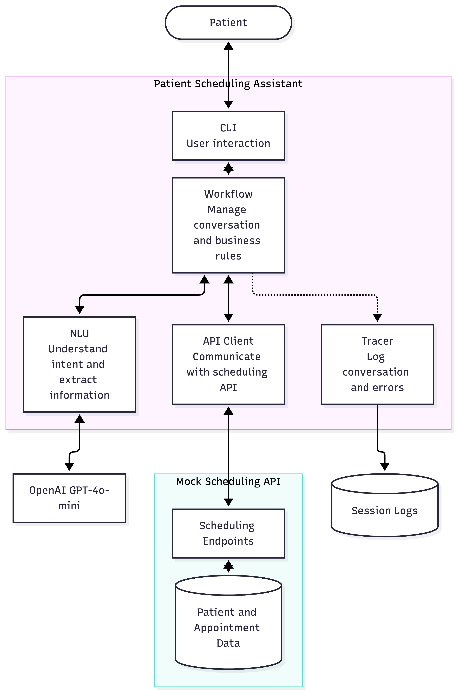
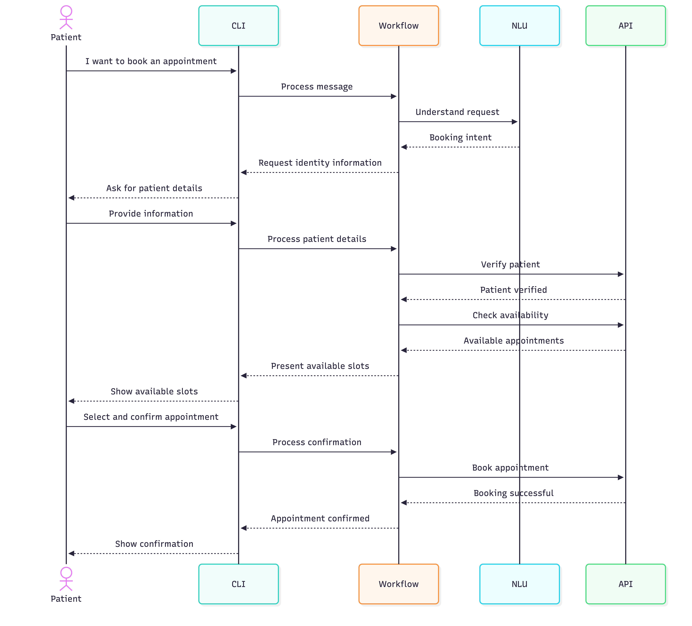

# AI Appointment Scheduling Assistant (prototype)

A text-based, multi-turn assistant that helps a patient find a provider, look up an
existing appointment, or book a new one against the provided mock scheduling API.

`I completed this within the assigned 3-hour window.`

* Python 3.8+, **standard library only** (no `pip install`). The OpenAI API is called over
  plain HTTPS; the key is read from the environment and is never written to disk or logs.
* Works with **or without** an OpenAI key: an LLM parser is used when `OPENAI_API_KEY` is
  set, and a deterministic rule-based parser otherwise (also the fallback if the LLM call
  fails). Both feed the same validated contract into the same workflow code.
* 13 scripted eval scenarios + 17 unit tests. The evals pass 13/13 with the rule parser
  (offline, a few seconds) and 13/13 with the OpenAI parser (`gpt-4o-mini`, about 2 s per turn).

---

## 1. Setup

```bash
git clone <this repo>
cd patient_appointment_project
python3 --version        # 3.8 or newer
cp .env.example .env     # then paste the temporary OpenAI key into .env (optional)
source .env              # or: export OPENAI_API_KEY="sk-..."
```

`.env` is git-ignored. Nothing else to install.

## 2. Start the provided mock scheduling API

```bash
python3 mock-api/server.py          # -> mock scheduling API on http://localhost:4010
```

Leave it running in its own terminal. State is in memory; restart it to reset bookings.

## 3. Run the assistant

```bash
python3 -m assistant.cli            # uses the OpenAI NLU if OPENAI_API_KEY is set
python3 -m assistant.cli --no-llm   # force the deterministic rule-based NLU
python3 -m assistant.cli --verbose  # also echo JSON trace events to stderr
```

Options: `--api-base URL` (default `http://localhost:4010`), `--trace-file PATH`
(default `traces/session-<timestamp>.jsonl`, `-` to disable), `--mock-scenario api_failure`
(send the mock's outage header on every request).

In-session slash commands: `/reset`, `/scenario api_failure`, `/scenario off`, `/state`, `/quit`.

### Example conversations

Provider lookup (no identity needed):

```
you> Which primary care providers are available downtown?
assistant> Here are the primary care providers at downtown I found:
             - Dr. Elena Brooks (primary care) - locations: downtown, uptown; visit types: in person, virtual
             - Dr. Marcus King (primary care) - locations: downtown; visit types: in person
```

Booking happy path:

```
you> I want to book a primary care appointment at the downtown clinic
assistant> To book that, I first need to verify who you are. Please share the phone number on your file and your date of birth ...
you> 555-0101 and 1985-04-12
assistant> Thanks, Maya - I found your record.
           Here's what's available:
             1. Tue Dec 1, 2026 at 9:00 AM - Dr. Elena Brooks at downtown
             2. Tue Dec 1, 2026 at 11:00 AM - Dr. Marcus King at downtown
             3. Wed Dec 2, 2026 at 8:30 AM - Dr. Marcus King at downtown
           Which one would you like? Reply with the number.
you> 1
assistant> You picked: Tue Dec 1, 2026 at 9:00 AM - primary care with Dr. Elena Brooks at downtown.
           Shall I book this appointment? Please reply 'yes' to confirm or 'no' to choose a different time.
you> yes
assistant> You're booked! primary care with Dr. Elena Brooks at downtown on Tue Dec 1, 2026 at 9:00 AM.
           Confirmation number: appt_9002 (status: scheduled).
```

Failure / handoff triggers (all from `mock-api/README.md`): phone `555-9999` + DOB
`1990-01-01` (no match), `555-0130` + `1978-09-22` (two matches, asks for zip),
"I have chest pain, should I wait?" (medical advice), picking the 8:30 AM downtown slot
(`slot_conflict_001`, always 409), dermatology at lakeside (nothing available),
`/scenario api_failure` (503 on every call), "talk to a human", "book a cardiology appointment".

## 4. Tests and evals (run these)

```bash
python3 -m unittest discover -s tests -v      # 17 offline unit tests, < 1 s
python3 -m evals.run_evals                    # 13 scenario evals; starts a fresh mock per scenario
python3 -m evals.run_evals -v -k slot_conflict  # print the conversation for one scenario
python3 -m evals.run_evals --llm              # same scripts through the OpenAI parser (needs key)
```

Evals assert on three things per turn: what the user saw (including that no patient data
leaks on failure paths), exactly which API calls were made with what status (e.g. exactly one
`POST /appointments` with `confirmed: true`, and none before the user said yes), and the
workflow state / handoff reason recorded in the trace. `scenarios.yaml` ids map 1:1 to
scenario ids in `evals/run_evals.py`, plus a few extra (decline-then-rebook, unresolved zip,
human request, unsupported specialty, existing-appointment lookup).

---

## 5. Architecture



Sequence of a typical booking conversation:



### Who decides what

| Decision | Owner | Why |
| --- | --- | --- |
| What the user *means* (intent), which entities are present, which numbered slot "the 11am one" refers to | **Model** (or rules) | Fuzzy language; the only place an LLM adds value here |
| Whether identity is required, when a confirmation counts, which API to call next, how to react to each status code, when to hand off and with which `reason` | **Code** (`workflow.py`) | Policy must be enforced deterministically and be testable offline |
| Who the patient is, what slots exist, whether a booking succeeded, the handoff id | **API** | The source of truth; nothing shown to the user originates anywhere else |
| Every user-facing sentence | **Code templates filled from API data** | Removes the fabrication risk entirely; the model never writes prose |

### Key design decisions

1. **The LLM is a parser, not an agent.** Each turn it receives the workflow state, what the
   workflow is expecting, the labels of the slots currently on screen, and the user message,
   and returns one JSON object. Every field is validated against enums/regexes/ranges in
   code; anything invalid is dropped (see `tests/test_units.py::LLMValidationTests`). No
   tool-calling loop, so there is exactly one model call per turn and the model cannot call
   `POST /appointments` by itself.
   Two things the live model did that the code had to absorb, both caught by the eval suite:
   it labels mid-flow answers like "1" or "primary care" as `book_appointment` /
   `find_providers`, so the workflow now routes on *what the state asked for* before it
   routes on intent; and it echoes the selected slot as `slot_choice` next to a `yes`, so a
   "yes" always books the slot named in the confirmation prompt and a slot change is only
   honoured when the text itself contains a number, ordinal, or time.
2. **PHI minimisation before the model.** Phone numbers and dates of birth are extracted
   locally with regexes and replaced with `<PHONE>` / `<DOB>` *before* the text is sent to
   OpenAI. Natural-language DOBs the regexes miss may still reach the model; its extraction
   is accepted only after validation.
3. **Defence in depth on the three hard rules.**
   * *Identity:* `_advance()` refuses to do anything patient-specific until a single
     patient is resolved; two matches force a zip-code question; two failed lookups (or a
     non-matching zip) hand off with `identity_unclear`.
   * *Confirmation:* a booking requires state `CONFIRM` **and** a parsed `yes` to the
     explicit "Shall I book this?" prompt. The API client additionally raises locally if
     asked to send `confirmed != True`. Saying "book slot 1, yes" in one message still gets
     a confirmation prompt - one extra turn is cheap compared with a wrong booking.
   * *Medical advice:* a deterministic keyword screen runs on every turn in addition to
     the model's label; either one triggers the `medical_advice` handoff. The reply gives
     no triage, only the standard "if this could be an emergency call 911" line.
4. **Fail closed, truthfully.** 503 or connection errors get one retry, then a handoff with
   `api_failure`. If the handoff endpoint is *also* down (which is what the mock's header
   does), the user is told plainly and given a real next step (call the front desk). A 409
   on booking re-fetches live availability rather than reusing the stale list, and the
   conflicting slot is suppressed for the rest of the session.
5. **Observability without PHI.** Every event is a JSON line with session, turn, latency
   and outcome. Identifiers are replaced with short one-way fingerprints so calls can be
   correlated but not read; free text is masked before logging. The eval harness reads the
   same trace to make its assertions, so the traces are tested too.

### Assumptions

* Phone numbers in the mock are seven digits (`555-0101`). Input is normalised to that form:
  10/11-digit numbers are reduced to their last seven digits.
* A verified patient stays verified for the session; identifiers are discarded from memory
  as soon as the lookup returns.
* The user's first name is echoed after verification ("Thanks, Maya") as confirmation that
  the right record was found. Nothing is echoed when zero or multiple records match.
* After a no-availability result, "yes"/"staff"/"human" means "please have staff find me a
  time", so the handoff reason is `no_availability` rather than `user_requested`.
* Location is asked for explicitly (with an "any" option) because the fixtures make it the
  deciding factor; specialty is required by the API.
* A slot that returned 409 is hidden for the rest of the session even if `/availability`
  still lists it, since the API has demonstrated its availability flag is stale.
* Times are rendered as returned by the API (fixed `-05:00` offset) without timezone
  conversion, per `data/README.md`.

### Known limitations

* The rule-based parser is keyword-driven; phrasing outside the eval scripts may fall to
  the generic "what would you like to do?" prompt. The LLM parser is the intended primary.
* The LLM path was validated against the 13 scripted scenarios only; paraphrase variants
  and adversarial inputs (prompt injection in the user message) have not been evaluated yet.
* No date-range filtering on `/availability` ("next week") and no provider preference
  ("with Dr. King") yet - both are simple additions to the parser contract and `_search_slots`.
* Single in-process session; no persistence, auth, or channel adapters.
* Templated replies are correct but plain. A safe way to add warmth is to let the model
  paraphrase a *template that already contains the data* and diff-check that every
  slot/time/id string survives verbatim.

## What I Would Do Next

These are the steps I would take to turn this prototype into a real product, in the order I would do them. The main design stays the same: the LLM only understands the message, the code enforces the rules, and the API is the source of truth.

1. **Connect to the real scheduling system.** Replace the mock API with the clinic's real scheduling system behind the same `SchedulingClient` interface, and add service authentication and rate-limit handling. I expect two things to break first:
   - **Booking retries:** The client retries a failed request once, including `POST /appointments`. If the first request succeeds but the response is lost, the retry returns 409 and the patient is told that nothing was booked, although an appointment exists. I would send an idempotency key with every booking, and when the result is unknown, check the patient's appointments before telling them anything.
   - **Time zones:** Times are shown exactly as the API returns them. I would show every time in the clinic's time zone and name the time zone in the message.
2. **Verify identity properly.** A phone number and a date of birth are easy for another person to know. I would send a one-time code to the phone number on file (or use the patient portal login), limit the number of attempts, and expire a verified session after a short period without activity.
3. **Run it as a service for many patients.** Move from the CLI to an HTTP service behind a web chat or SMS channel. The `Session` dataclass already holds all conversation state, so I would store it in Redis or a database with an expiry time. Then many patients can talk at the same time, and a conversation survives a restart.
4. **Meet healthcare privacy requirements.** Before using real patient data, I would need a signed agreement with the LLM provider that covers patient data (a BAA under HIPAA) with no data retention, encryption in transit and at rest, secrets in a secrets manager, and an audit log of every access to a patient record. I would also improve the masking to cover more date formats, names, and addresses.
5. **Build a larger eval set and run it on every change.** Grow from 13 scenarios to a few hundred: different wording, typos, several requests in one message, prompt injection, and many forms of medical questions. Every change to the prompt, model, or workflow must pass before release, and a policy failure (booking without confirmation, a data leak, a missed medical handoff) blocks the release. After launch, I would add failed real conversations to the set, with patient data removed.
6. **Add monitoring and alerts.** Send the existing structured traces to a central system and build a dashboard for booking success rate, handoff rate by reason, API error rate, LLM fallback rate, response time per step, and cost per conversation. Alert when any of these changes suddenly.
7. **Control response time and cost.** Today every turn calls the LLM (about 2 seconds), even for answers like "1" or "yes" that the rule parser already understands. I would skip the LLM for those turns. In the booking example above, that is three of the four turns. I would also lower the LLM timeout from 20 seconds to a few seconds before falling back to the rules.
8. **Roll out gradually, with a quick way back.** Start with internal staff, then one clinic and a small share of patients, and expand only while the metrics stay healthy. Add switches to turn off the LLM parser (the rule-only mode already exists), to turn off booking, or to send every conversation to staff. Keep the prompt and model name in versioned configuration, so a rollback is a configuration change and not a code change.
9. **Add new features after the foundation is stable.**
    - **Reschedule and cancel:** Use the same identity check and explicit confirmation as booking. For a reschedule, book the new slot first and cancel the old one only after that succeeds, so the patient never loses both. If the cancel step fails, hand off to staff with both appointment numbers.
    - **Better search:** Support date ranges, a preferred provider, and requests such as "find me the earliest available appointment."
    - **More natural replies:** Let the LLM improve the wording, but keep every time, name, and confirmation number filled in by code from API data.

### Adding reschedule and cancel

Both are patient-specific, so they reuse the identity gate unchanged. Cancel: new intent
`cancel_appointment` → `GET /patients/{id}/appointments` → user picks one from the list
(same numbered-choice mechanics as slots) → explicit "Cancel appointment X on <time>?
yes/no" → `DELETE /appointments/{id}` (or `PATCH status=cancelled`). Reschedule = cancel's
selection step + booking's slot search and confirmation, ideally as one atomic server call
(`POST /appointments/{id}/reschedule {slotId, confirmed}`) so the patient can never end up
with zero appointments if the second half fails. Both need a 409/404 path ("already
cancelled", "slot taken") handled exactly like booking's conflict path.

### Production notes

* **Cost / latency at volume:** one small-model call per turn with a ~700-token prompt is
  roughly $0.0002 and measured 1.5-3 s with `gpt-4o-mini` (the mock API adds ~1 ms). Short replies
  ("yes", "2", a bare phone number) are already resolved by the rules layer and could skip
  the model entirely. Cache the provider list; batch nothing else since every call is on
  the user's critical path.
* **Monitoring:** per-turn `turn_summary` events give intent distribution, state
  transitions, handoff reasons, API status codes and latency. Alert on handoff rate by
  reason (an `api_failure` spike is the backend; an `identity_unclear` spike is the
  parser), on 409 rate, and on `rules_fallback` rate (the LLM is degraded).
* **Rollout / rollback:** ship behind a per-clinic flag with the deterministic parser as the
  always-available fallback; canary the LLM parser on a slice and compare handoff and
  completion rates; roll back by flipping the parser flag, not redeploying.
* **What breaks first with a real scheduling system:** availability is far more volatile
  (expect many more 409s - hold/reserve a slot before asking for confirmation), identity
  needs real verification (more than phone+DOB), time zones and DST are real, and PHI sent
  to the model provider requires a BAA and zero-retention configuration.

### Repository layout

```
assistant/       api_client.py  nlu.py  workflow.py  tracing.py  cli.py
evals/           run_evals.py  (scenario harness, starts its own mock)
tests/           test_units.py (offline unit tests)
mock-api/ openapi/ data/ policies.md scenarios.yaml assignment.md   (provided package)
.env.example     environment variables; .env is git-ignored
```

